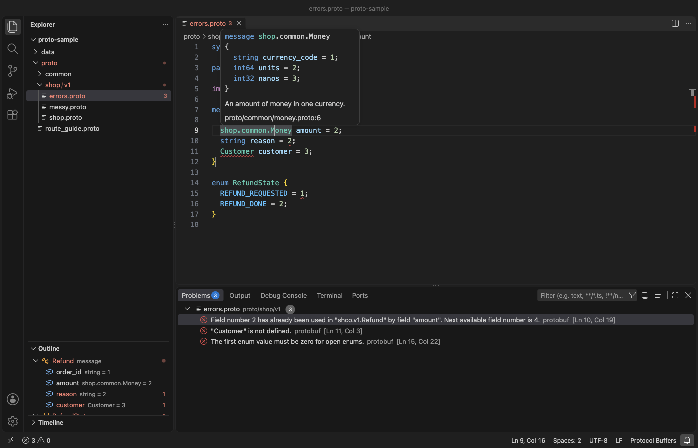

# Protobuf & Proto3 Formatter

Protobuf support for VS Code, by Zovo: syntax highlighting, a formatter that keeps every comment, go to definition, find references and error marks that match protoc. For proto2, proto3 and editions (2023, 2024). It runs offline with its own parser, so there is no protoc, no language server and no setup.

## Free, with no sign-in and no network

- Highlighting for `.proto` files and for `proto` code blocks in Markdown.
- Format Document: one statement per line, the indentation of your editor, single spaces around `=`. Comments, blank-line groups and your line breaks in long statements stay where they were. A file with a syntax error is left alone. Works with format on save.
- Go to definition and find references across imports, with the protobuf scoping rules (nested types, packages, leading `.`). Ctrl or Cmd click an import to open the file.
- Diagnostics with the protoc wording: duplicate field numbers (with the next free number), unknown types, types used without their import, reserved numbers and names, field numbers out of range, proto3 rules (first enum value 0, no `required`, no defaults), editions rules, enum aliases, map keys, oneof labels, extension ranges. Unused imports are faded.
- No false red marks: when an import is not in your workspace, the extension says so on the import line and does not guess about the types it would bring.
- Outline, breadcrumbs and Go to Symbol in workspace for messages, fields, enums, services and methods.
- Hover a type to see its fields and its comment. Completion for types, keywords, options, import paths and the next free field number after `=`.
- Built-in names for the well-known types (`google/protobuf/timestamp.proto` and the others).

## Pro tools

Zovo Pro: USD 19 once, for the Pro tools of every Zovo extension. Each tool has 3 free tries first, with no account.

- Check breaking changes against git: compares your .proto files with main (or a branch you set) and lists removed fields, changed numbers, types and labels, renamed fields and enum values, and removed or changed methods. Each finding says whether it breaks binary data, JSON or only generated code. Saves a JSON file for CI.
- Generate API docs: one Markdown file or one self-contained HTML page with every service, method (and its HTTP route), message, field and enum, with your comments.
- Decode a binary message: protobuf bytes from a file, hex or base64 become readable JSON with your schema (field names, enums, maps, nested messages, packed fields), or with field numbers only. A gRPC frame header is removed for you.

The Pro tools are in the editor right-click menu of a `.proto` file and in the Explorer right-click menu (folders, `.proto` files, and `.bin` or `.pb` files for the decoder).

## How to use

1. Open a folder with `.proto` files. Highlighting and the outline start at once.
2. Format with Shift+Alt+F (Shift+Option+F on macOS), or turn on `editor.formatOnSave`.
3. F12 on a type or an import goes to its definition. Shift+F12 lists its uses.
4. If your imports start from a folder such as `proto/` or `third_party/`, the extension finds them by walking up from each file. For other roots, add them to `zovoProto.importPaths`, as you would with `protoc -I`.

## Settings

| Setting | Default | What it does |
| --- | --- | --- |
| `zovoProto.importPaths` | `[]` | Extra import roots, like `protoc -I`. Relative paths start at the workspace folder. |
| `zovoProto.diagnostics` | `true` | Show the protoc-style errors in open files. |
| `zovoProto.unusedImports` | `true` | Fade imports that nothing uses. |
| `zovoProto.maxFiles` | 5000 | How many .proto files to index. |
| `zovoProto.exclude` | node_modules, bazel-*, .git | Folders not to index. |
| `zovoProto.baseBranch` | (auto) | Branch for the breaking-change check. |

## Privacy

The extension reads files on your computer and nothing else. It makes no network requests and has no telemetry. The breaking-change check runs your local `git`. The Pro tools write files only where you choose.

## Known limits

- Custom option names are checked for their import but not against the extension's field type.
- The editions feature checks cover `enum_type`, labels, `packed` and groups. Other feature rules are left to protoc.
- The formatter keeps your line breaks inside long statements. It does not wrap long lines and does not align `=` in columns.
- Formatting needs a file that parses. Fix the error the Problems panel shows first.

## Support Zovo

Zovo Pro: USD 19 once, every Zovo viewer. [Get Zovo Pro on GitHub Sponsors](https://github.com/sponsors/theluckystrike/sponsorships?tier_id=679878) to turn on the Pro tools in this extension and in the other Zovo extensions you use. The free features stay free.

Zovo extensions have no ads and no tracking. They are made by [theluckystrike](https://github.com/theluckystrike) on GitHub. You can also support the work with no Pro:

- [Sponsor on GitHub](https://github.com/sponsors/theluckystrike)
- [PayPal](https://www.paypal.com/paypalme/najzzz)
- [Follow theluckystrike on GitHub](https://github.com/theluckystrike)

### Need your format supported?

Open a [format request](https://github.com/theluckystrike/protobuf-vscode/issues/new?template=format-request.yml) with a sample file, and I reply there whether it can be done. For USD 299 once, through [this GitHub Sponsors tier](https://github.com/sponsors/theluckystrike/sponsorships?tier_id=679995), I add your file format or a missing feature to this extension, with tests, within 7 days.

## More tools by Zovo

- [Swagger Viewer & OpenAPI Viewer (OpenAPI Preview, 3.1, $ref)](https://marketplace.visualstudio.com/items?itemName=zovo.swagger-openapi-viewer) lints and previews OpenAPI and Swagger specs in YAML or JSON.
- [Load Testing & HTTP Load Tests for APIs (Performance Testing, Reports)](https://marketplace.visualstudio.com/items?itemName=zovo.zovo-load-testing) load tests HTTP APIs from a small YAML file, with no account.
- [HAR Viewer & HAR File Analyzer (HTTP Archive, Network Log)](https://marketplace.visualstudio.com/items?itemName=zovo.zovo-har-viewer) opens HAR files from browser DevTools with a timing waterfall, filters and a redacted copy for sharing.
- [SARIF Viewer (CodeQL, Semgrep & Static Analysis Results)](https://marketplace.visualstudio.com/items?itemName=zovo.zovo-sarif-viewer) shows SARIF results from CodeQL, Semgrep and ESLint, with filters.
- [JavaScript Playground & TypeScript Scratchpad with Inline Values (Live JS and TS Runner)](https://marketplace.visualstudio.com/items?itemName=zovo.zovo-js-ts-scratchpad) shows the value of each line of JavaScript or TypeScript as you type.

See [all Zovo extensions on the Marketplace](https://marketplace.visualstudio.com/publishers/zovo).

## License

MIT

## More from zovo

- [All free zovo VS Code extensions](https://marketplace.visualstudio.com/publishers/zovo) — file viewers, database clients, formatters. Offline, no telemetry, no sign-up.
- [Full MCP server catalogue](https://theluckystrike.github.io/mcp/) — local-first MCP servers for back-office work: invoices, VAT, PDFs, spreadsheets, payroll.
- [Hosted no-install MCP endpoints](https://mcp.zovo.one) — paste a URL in Claude / Cursor, nothing to install.
